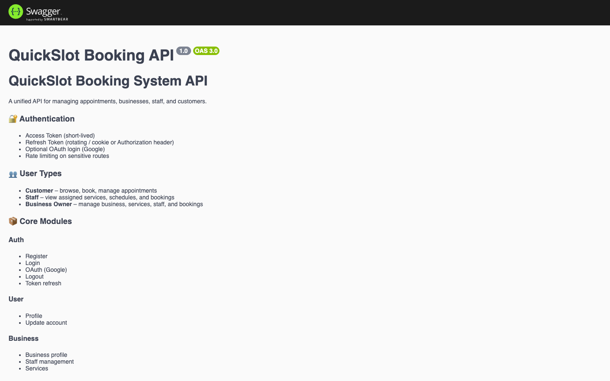

# Booking API

A REST API for appointment booking, with separate roles for customers, staff and business owners.

<!-- Screenshot: add an image of the Swagger docs page here -->
<!--  -->

## The problem

A service business needs one place to manage its services, its staff and its appointments.
Customers, staff and owners each need different access to the same data.
This API gives each role its own set of endpoints and checks the role on the server.

## Features

- Register and log in with email and password. Passwords are hashed with Argon2.
- Short-lived access tokens and rotating refresh tokens, stored as sessions in the database.
- Google sign-in (OAuth 2.0).
- Role checks on protected routes: `CUSTOMER`, `STAFF`, `BUSINESS_OWNER`, `ADMIN`.
- Business owners can create a business profile, invite and manage staff, and view booking, revenue, staff and service statistics.
- Business owners can create, edit, deactivate and delete services.
- Staff can view their profile, assigned services, schedule, bookings and statistics.
- Customers can create, view, change and cancel bookings. The API rejects a time slot that conflicts with another booking.
- Owners and staff can view bookings and update the booking status.
- Rate limiting on all routes, with stricter limits on register, login and token refresh.
- Request validation on every route, and Swagger docs at `/api/v1/docs`.

## Tech stack

- NestJS 11 and TypeScript
- PostgreSQL with Prisma 7
- Passport JWT and Google OAuth
- Swagger (OpenAPI)
- Jest
- pnpm

## Run locally

You need:

- Node.js 20.19+, 22.12+ or 24+ (the versions Prisma 7 supports)
- pnpm 12
- A PostgreSQL database

```bash
pnpm install
cp .env.example .env
pnpm exec prisma generate
pnpm exec prisma migrate deploy
pnpm exec prisma db seed
pnpm start:dev
```

The API runs at `http://localhost:4000/api/v1`.
The Swagger docs are at `http://localhost:4000/api/v1/docs`.
The seed creates one business owner account. The login details are in `prisma/seed.ts`.

### Environment variables

Set these in `.env`. The values in `.env.example` are fake.

| Variable                 | Purpose                                              |
| ------------------------ | ---------------------------------------------------- |
| `DATABASE_URL`           | PostgreSQL connection URL                            |
| `JWT_SECRET_KEY`         | Secret that signs access tokens                      |
| `JWT_REFRESH_SECRET`     | Secret that signs refresh tokens                     |
| `JWT_ACCESS_EXPIRES_IN`  | Access token lifetime. Default `30m`                 |
| `JWT_REFRESH_EXPIRES_IN` | Refresh token lifetime. Default `7d`                 |
| `GOOGLE_CLIENT_ID`       | Google OAuth client ID                               |
| `GOOGLE_CLIENT_SECRET`   | Google OAuth client secret                           |
| `GOOGLE_REDIRECT_URI`    | Google OAuth callback URL                            |
| `FRONTEND_URL`           | Where the API redirects after Google sign-in         |
| `PORT`                   | Optional. Port the API listens on. Default `4000`    |

### Other commands

```bash
pnpm build        # compile to dist/
pnpm start:prod   # run the compiled build
pnpm typecheck    # TypeScript check
pnpm lint         # ESLint with auto-fix
pnpm test         # unit tests
```

## API overview

All routes start with `/api/v1`.

| Area     | Routes                                                                 |
| -------- | ---------------------------------------------------------------------- |
| Auth     | `POST /auth/register`, `/auth/login`, `/auth/refresh`, `/auth/logout`  |
| Google   | `GET /auth/google`, `GET /auth/google/callback`                        |
| User     | `GET /user/profile`, `PATCH /user/profile`                             |
| Business | `/business/profile`, `/business/stats/*`, `/business/staff/*`          |
| Service  | `/service`, `/service/all`, `/service/:id`, `/service/:id/toggle`      |
| Staff    | `/staff/profile`, `/staff/services`, `/staff/schedule`, `/staff/stats` |
| Booking  | `/booking`, `/booking/my`, `/booking/owner/*`, `/booking/staff/my`     |

See the Swagger docs for request and response details.

## Status and what's next

This is a work in progress. It is not deployed.

- The booking routes have no automated tests yet.
- The database schema has `Payment` and `EmailLog` models. No payment provider or email sending is connected yet.
- The end-to-end test in `test/` does not run yet. Only the default unit test passes.
- The production CORS origin in `src/main.ts` is a placeholder.

Next: add tests for the booking rules, and connect payments.

---

Built by [Adedamola](https://github.com/signordemola) · [Demola Studio](https://www.demolastudio.com)

See also: [booking-engine](https://github.com/signordemola/booking-engine)
